# TRACE 2.0 — Trustworthy Regulatory Assurance & Compliance Engine

> **Next-Generation AICTE Statutory Scrutiny & Regulatory Assurance Platform with GPU Document-AI, Deterministic Verification, Shadow Replay, Incremental Reprocessing, Scrutiny Priority ML, and Cryptographic Evidence Lineage.**

[](https://www.typescriptlang.org/)
[](https://react.dev/)
[](https://expressjs.com/)
[](https://fastapi.tiangolo.com/)
[](https://www.postgresql.org/)
[](https://www.prisma.io/)
[](https://pytorch.org/)
[](https://vitejs.dev/)

---

## 1. Project Description

**TRACE 2.0** is an enterprise regulatory assurance and compliance engine purpose-built for statutory regulatory bodies (such as the **All India Council for Technical Education — AICTE**; Smart India Hackathon problem statement **SIH26261**). Technical campuses submit dense multi-page documentation (building completion certificates, municipal fire NOCs, land title deeds, fixed deposit receipts, and governing resolutions) across annual approval and scrutiny cycles.

Traditional verification relies on manual audits or keyword search that silently fail on multi-document date mismatches, units disparity (acres vs. hectares vs. sq. meters), post-dated certificates, and version regressions.

### Decision-Support Guarantee
TRACE is an end-to-end **regulatory compliance decision-support platform**. All outputs—including OCR extractions, rule evaluations, cross-document discrepancy checks, anomaly indicators, ML/DL priority scores, and downloadable audit reports—are **decision-support findings** to assist authorized human scrutiny officers. TRACE never automatically declares an institution fraudulent or issues a final statutory approval, rejection, or adverse regulatory penalty without authorized human review and sign-off.

TRACE transforms this regulatory scrutiny workflow through **seven integrated differentiated features**:

1. **ChronoGraph**: Cross-document contradiction graph that normalizes atomic claims and isolates temporal, value, and stale-validity contradictions with clickable bounding-box evidence across an 11-node evidence graph.
2. **RuleReplay**: Regulatory change impact simulator running draft handbook amendments in shadow mode across stored evidence without altering production records, protected by an authorized publication gate.
3. **DeltaScan**: Incremental document reprocessing using per-page SHA-256 fingerprinting and caching, reducing re-analysis compute time by 50–90%.
4. **FixPreview**: Counterfactual correction sandbox allowing institutions and reviewers to test hypothetical values safely without altering official findings.
5. **ReviewPilot**: Explainable review queue prioritization with deterministic scoring factors (severity, contradictions, OCR uncertainty, deadlines) and reviewer workload balancing.
6. **Proofline**: Cryptographically verifiable evidence lineage generating append-only, SHA-256 hash-chained validation manifests.
7. **System Control & ML Management Center**: Live held-out evaluation with confusion matrices for ML/DL models (TF-IDF classifier, Layout CNN, Compliance GBDT), an automated executable dataset manager (`scripts/datasets.py`), audit trail verification, and synchronized dual-format JSON/PDF statutory reports.

---

## 2. High-Level Architecture Diagram

```mermaid
graph TB
    subgraph ClientLayer ["Frontend UI Layer (React 19 + TypeScript + Vite 8.3 + Vanilla/Tailwind CSS)"]
        UI_Dash["Executive Control Tower & My Work"]
        UI_DocAI["AI Document Intelligence & ChronoGraph"]
        UI_Rules["Regulatory Rulebook & RuleReplay Sandbox"]
        UI_Queue["Verification Queue & ReviewPilot Prioritization"]
        UI_Audit["Proofline Lineage & Immutable Audit Trail"]
        UI_Sandbox["Evidence-to-Action Drawer & FixPreview"]
        UI_Reports["Synchronized PDF & JSON Reports Generator"]
        UI_Settings["ML Model Evaluation & Dataset Management"]
        UI_Copilot["Air-Gapped Offline Regulatory Copilot"]
    end

    subgraph GatewayLayer ["Node.js / Express 4.21 Gateway (Port 3000)"]
        AUTH["Session RBAC Guard & Tenant Isolation<br/>(5 Distinct Roles & Multi-Tenant Scoping)"]
        ROUTER_APP["/api/applications (Stage, Graph & Contradictions)"]
        ROUTER_DOCS["/api/documents (Upload, Magic-Byte & DeltaScan)"]
        ROUTER_RULES["/api/regulations (RuleSet & RuleReplay)"]
        ROUTER_FINDINGS["/api/findings (Tasks & FixPreview)"]
        ROUTER_QUEUE["/api/review-queue (ReviewPilot)"]
        ROUTER_PROV["/api/provenance (Proofline Hash Chain)"]
        ROUTER_REPORTS["/api/reports (Dual-Format JSON & PDF Gen)"]
        ROUTER_SETTINGS["/api/settings (System Controls & Auditing)"]
        ROUTER_COPILOT["/api/copilot (Sanitized Offline/Ollama RAG)"]
        FASTAPI_CLIENT["FastAPI Microservice Bridge & Lifecycle Mgr"]
    end

    subgraph InferenceLayer ["Python FastAPI Document-AI & ML Engine (Port 8000 — Miniconda dgpu-core)"]
        PY_OCR["PyMuPDF 1.25 + EasyOCR 1.7<br/>(NVIDIA RTX 5060 GPU / CPU Fallback)"]
        PY_CHRONO["ChronoGraph Analyzer<br/>(Atomic Claim Extraction & Bounding Boxes)"]
        PY_DELTA["DeltaScan Fingerprinter<br/>(Per-Page SHA-256 Diff & Cache Reuse)"]
        PY_REPLAY["RuleReplay Shadow Engine<br/>(Ruleset Diff & Shadow Application Replay)"]
        PY_PILOT["ReviewPilot Scorer<br/>(Explainable Priority Formula)"]
        PY_PROOFLINE["Proofline Manifest Generator<br/>(Canonical SHA-256 Hash Chain)"]
        PY_ML["System ML Router (/system_ml)<br/>Held-Out Evaluation, Metrics & Datasets"]
        
        subgraph ML_Models ["Trained ML/DL Model Artifacts (fastapi_engine/models/)"]
            M_TFIDF["DocTextTFIDFClassifier<br/>TF-IDF + LogReg (0.1 MB)"]
            M_CNN["DocumentLayoutCNN<br/>PyTorch 3-Layer ConvNet (2.1 MB)"]
            M_GBDT["ComplianceRiskGBDT<br/>Scikit-Learn GBDT (0.6 MB)"]
        end
    end

    subgraph DataLayer ["Data & Storage Layer (Native Windows — Containerless)"]
        PG[("PostgreSQL 18 Database (Port 5433)<br/>37 Relational Models via Prisma ORM")]
        FS[("Secure Local File Vault<br/>UUID-Indexed Storage Outside Web Root")]
        DS[("Datasets Repository (datasets/)<br/>FUNSD Benchmark + AICTE Synthetic Corpus")]
    end

    UI_Dash --> AUTH
    UI_DocAI --> AUTH
    UI_Rules --> AUTH
    UI_Queue --> AUTH
    UI_Audit --> AUTH
    UI_Sandbox --> AUTH
    UI_Reports --> AUTH
    UI_Settings --> AUTH
    UI_Copilot --> AUTH

    AUTH --> ROUTER_APP
    AUTH --> ROUTER_DOCS
    AUTH --> ROUTER_RULES
    AUTH --> ROUTER_FINDINGS
    AUTH --> ROUTER_QUEUE
    AUTH --> ROUTER_PROV
    AUTH --> ROUTER_REPORTS
    AUTH --> ROUTER_SETTINGS
    AUTH --> ROUTER_COPILOT

    ROUTER_APP --> PG
    ROUTER_DOCS --> PG
    ROUTER_RULES --> PG
    ROUTER_FINDINGS --> PG
    ROUTER_QUEUE --> PG
    ROUTER_PROV --> PG
    ROUTER_REPORTS --> PG
    ROUTER_SETTINGS --> PG
    ROUTER_COPILOT --> PG

    ROUTER_DOCS --> FS

    FASTAPI_CLIENT --> PY_OCR
    FASTAPI_CLIENT --> PY_CHRONO
    FASTAPI_CLIENT --> PY_DELTA
    FASTAPI_CLIENT --> PY_REPLAY
    FASTAPI_CLIENT --> PY_PILOT
    FASTAPI_CLIENT --> PY_PROOFLINE
    FASTAPI_CLIENT --> PY_ML

    PY_ML --> M_TFIDF
    PY_ML --> M_CNN
    PY_ML --> M_GBDT
    PY_ML --> DS
```



---

## 3. The Seven Differentiated Features

```mermaid
flowchart TD
    subgraph F1 ["1. ChronoGraph (11-Node Evidence Graph)"]
        C1["Raw PDF Evidence"] --> C2["Extract Atomic Claims"]
        C2 --> C3["Deterministic Normalization<br/>(Area, Dates, Intake)"]
        C3 --> C4["Cross-Doc Contradiction Graph<br/>(Temporal, Value, Stale)"]
        C4 --> C5["Traverse 11 Node Relational Graph<br/>(App → Doc → Version → Field → Clause → Finding → Decision)"]
    end

    subgraph F2 ["2. RuleReplay (Regulatory Simulator)"]
        R1["Draft Handbook Amendment"] --> R2["Clause Semantic Diff"]
        R2 --> R3["Shadow Replay on Applications"]
        R3 --> R4["Impact Report<br/>(Production Unchanged)"]
        R4 --> R5["Authorized Admin Publication Gate"]
    end

    subgraph F3 ["3. DeltaScan (Incremental Reprocessing)"]
        D1["New PDF Revision (v2.0)"] --> D2["Page SHA-256 Fingerprint"]
        D2 --> D3{"Cached Page Hash?"}
        D3 -- Yes --> D4["REUSE_CACHE<br/>(0ms compute)"]
        D3 -- No --> D5["REPROCESS_PAGE<br/>(Targeted Re-eval)"]
        D4 & D5 --> D6["Measure Savings % (50-90% Compute Reduction)"]
    end

    subgraph F4 ["4. FixPreview (Counterfactual Sandbox)"]
        X1["Active Deficiency Finding"] --> X2["Hypothetical Correction Input"]
        X2 --> X3["Deterministic Sandbox Test"]
        X3 --> X4["Would Resolve Preview<br/>(Official Finding UNCHANGED)"]
    end

    subgraph F5 ["5. ReviewPilot (Uncertainty-Aware Queue)"]
        P1["Pending Queue Items"] --> P2["Severity + Contradictions + OCR + Deadlines"]
        P2 --> P3["Deterministic Explainable Score"]
        P3 --> P4["Fair Reviewer Workload Allocation"]
    end

    subgraph F6 ["6. Proofline (Cryptographic Lineage)"]
        L1["Assessment Outcomes"] --> L2["Canonical SHA-256 Payload"]
        L2 --> L3["Predecessor Hash Pointer"]
        L3 --> L4["Tamper-Evident Hash Chain Verification"]
    end

    subgraph F7 ["7. System Control, ML & Reports"]
        S1["Trained ML/DL Artifacts"] --> S2["Live Held-Out Evaluation with Confusion Matrix"]
        S3["Dataset CLI (scripts/datasets.py)"] --> S4["Verified FUNSD & Synthetic Corpus"]
        S5["Persisted Validation Run"] --> S6["Synchronized JSON & PDF Audit Reports"]
    end
```



---

## 4. Software Packages & Dependencies

### Frontend & UI Packages

| Package | Version | Purpose |
| :--- | :--- | :--- |
| `react` | `^19.0.1` | Core declarative UI component library |
| `react-dom` | `^19.0.1` | React DOM rendering engine |
| `react-router` / `react-router-dom` | `^7.18.4` | Application routing and deep-linking |
| `lucide-react` | `^0.546.0` | Accessible iconography system |
| `motion` | `^12.23.24` | Hardware-accelerated transitions & drawer micro-animations |
| `recharts` | `^3.10.1` | Analytics, workload balance, and compliance metrics charts |
| `sonner` | `^2.0.8` | High-fidelity toast notifications |
| `@tanstack/react-query` | `^5.104.5` | Async server state cache and synchronization |
| `@reduxjs/toolkit` | `^2.13.0` | Client-side application store management |
| `react-hook-form` | `^7.90.0` | High-performance form validation |
| `@hookform/resolvers` | `^6.0.0` | Form resolver bridge for schema validation |
| `zod` | `^4.6.7` | Runtime type inference and schema validation |
| `clsx` / `tailwind-merge` | `^2.1.1` / `^3.7.0` | Dynamic style merging and utility handling |
| `class-variance-authority` | `^0.7.1` | Typed UI component variant design tokens |
| `@tailwindcss/vite` | `^4.3.3` | Tailwind CSS integration for Vite |
| `vite` | `^8.3.5` | Ultra-fast client bundler and HMR server |

### Backend & Middleware Packages (Node.js)

| Package | Version | Purpose |
| :--- | :--- | :--- |
| `express` | `^4.21.2` | Core HTTP REST API framework |
| `prisma` / `@prisma/client` | `^6.4.1` | Type-safe PostgreSQL ORM & schema migration engine (37 models) |
| `bcryptjs` | `^3.0.3` | Salted credential hashing (`TraceSecure2026!`) |
| `cookie-parser` | `^1.4.7` | Secure HTTP-only cookie session handling |
| `cors` | `^2.8.6` | Cross-Origin Resource Sharing control |
| `dotenv` | `^17.2.3` | Environment configuration manager |
| `multer` | `^2.4.0` | Multipart streaming for PDF document uploads |
| `pdf-parse` | `^2.4.5` | Fast native server-side text extraction |
| `pdfkit` | `^0.15.0` | Deterministic binary PDF report generation |
| `nodemailer` | `^10.1.7` | SMTP dispatch for statutory task alerts |
| `supertest` | `^7.3.1` | Integration testing HTTP assertions |
| `vitest` | `^5.0.5` | Unit and end-to-end test execution framework |
| `tsx` | `^4.19.3` | Zero-config TypeScript script execution |

### Python Document-AI & ML Inference Packages

| Package | Version | Purpose |
| :--- | :--- | :--- |
| `fastapi` | `>=0.115.0` | High-throughput asynchronous inference API |
| `uvicorn` | `>=0.30.0` | High-performance ASGI server for Python microservice |
| `pydantic` | `>=2.8.0` | Strict data validation & contract serialization |
| `pymupdf` (`fitz`) | `>=1.24.0` | High-precision PDF layout block parsing & page rendering |
| `easyocr` | `>=1.7.0` | Deep-learning OCR with CUDA acceleration & CPU fallback |
| `torch` | `>=2.2.0` | PyTorch neural runtime with CUDA 13.0 GPU bindings |
| `scikit-learn` | `>=1.4.0` | TF-IDF text classification & GBDT compliance risk scoring |
| `joblib` | `>=1.3.0` | Serialized model artifact persistence and loading |
| `python-multipart` | `>=0.0.9` | Multipart file upload parsing for Python endpoints |
| `requests` | `>=2.31.0` | HTTP client for inter-service communication |

---

## 5. Machine Learning & Deep Learning Inventory

All models are trained via `python train_models.py` with stratified held-out splits (`70% train / 15% val / 15% test`) and persisted under `fastapi_engine/models/`.

| Model ID | Architecture | Purpose | Size | Held-Out Metrics | Fallback Mode |
| :--- | :--- | :--- | :--- | :--- | :--- |
| `doc-text-tfidf-logreg` | TF-IDF (1,2-gram) + LogisticRegression | Document category classification (5 statutory classes) | `0.10 MB` | 100.0% Accuracy, 1.000 F1 on held-out text | Prob `< 0.55` routes to `"unknown / needs_review"` |
| `doc-layout-cnn` | PyTorch 3-Layer ConvNet + BatchNorm | Page visual layout classification | `2.10 MB` | 100.0% Accuracy on synthetic layout tensors | Automatic CPU execution / heuristic fallback |
| `compliance-risk-gbdt` | Scikit-Learn GradientBoostingClassifier | Application review urgency & risk tiering | `0.62 MB` | 92.44% Accuracy, 89.19% Macro-F1 | Fallback to deterministic weighted scoring |

Live held-out evaluation with interactive confusion matrices is available via `POST /system_ml/models/{id}/evaluate` and displayed in the Settings Control Center.

---

## 6. Directory Structure

```text
trace-—-regulatory-assurance-&-compliance-engine/
├── .env.example                       # Documented environment template
├── AI.md                              # Core architectural & feature specification
├── README.md                          # Repository documentation & architecture guide
├── requirements.txt                   # Python FastAPI Document-AI dependencies
├── package.json                       # Node.js dependencies and lifecycle scripts
├── tsconfig.json                      # Strict TypeScript compiler options
├── vite.config.ts                     # Vite client bundling configuration
├── vitest.config.ts                   # Vitest testing configuration
├── train_models.py                    # Stratified ML/DL model training script
│
├── datasets/                          # Retained benchmark and synthetic datasets (26.7 MB total)
│   ├── dataset_manifest.json          # Cryptographic SHA-256 manifests and splits
│   ├── funsd/                         # Form Understanding in Noisy Scanned Documents (199 forms)
│   └── trace-regulatory-synth/        # AICTE synthetic compliance records
│
├── fastapi_engine/                    # Python Document-AI & ML Inference Engine
│   ├── main.py                        # FastAPI entrypoint (OpenMP conflict protected)
│   ├── models/                        # Serialized ML/DL models (TF-IDF, CNN, GBDT, splits)
│   └── routers/
│       ├── chronograph.py             # ChronoGraph claim extraction & contradiction detection
│       ├── deltascan.py               # DeltaScan SHA-256 fingerprinting & cache reuse
│       ├── document_ai.py             # PyMuPDF block parser & EasyOCR GPU pipeline
│       ├── proofline.py               # Proofline canonical hash-chain generator & verifier
│       ├── reviewpilot.py             # ReviewPilot explainable queue priority scoring
│       ├── rulereplay.py              # RuleReplay semantic diff & shadow evaluation
│       └── system_ml.py               # Held-out evaluation, confusion matrix & dataset manager
│
├── prisma/
│   └── schema.prisma                  # PostgreSQL schema with 37 relational models
│
├── scripts/
│   ├── datasets.py                    # Executable Dataset Manager CLI (download, validate, prepare)
│   ├── process_document.py            # Headless document processing utility
│   └── seed_document_pages.ts         # Page fingerprint seeding script
│
├── server/                            # Node.js Express Gateway
│   ├── db/
│   │   ├── prisma.ts                  # Shared Prisma ORM client instance
│   │   └── seed.ts                    # Statutory regulations, institutions, seed data
│   ├── middleware/
│   │   └── auth.ts                    # Session authentication & multi-tenant isolation guard
│   ├── routes/
│   │   ├── applications.ts            # Application stages, 11-node evidence graph, contradictions
│   │   ├── auth.ts                    # Role-based authentication & session handling
│   │   ├── copilot.ts                 # Sanitized offline regulatory copilot
│   │   ├── documents.ts               # Document upload, magic-byte validation & DeltaScan
│   │   ├── findings.ts                # Compliance findings, tasking & FixPreview sandbox
│   │   ├── provenance.ts              # Proofline manifests & cryptographic verification API
│   │   ├── reports.ts                 # Synchronized dual-format JSON & binary PDF generation
│   │   ├── review-queue.ts            # ReviewPilot prioritized review queue API
│   │   ├── rules.ts                   # Ruleset versioning, comparison & shadow replay API
│   │   ├── settings.ts                # System settings, audit log, ML evaluation bridge
│   │   └── state.ts                   # Unified state snapshot endpoint
│   ├── services/
│   │   ├── audit-service.ts           # Append-only audit logging service
│   │   ├── fastapi-service.ts         # FastAPI microservice lifecycle & typed API client
│   │   ├── ocr-service.ts             # OCR fallback & text extraction service
│   │   └── validation-engine.ts       # Statutory clause validation & anomaly triage logic
│   └── server.ts                      # Express HTTP server & Vite dev middleware
│
├── src/                               # Frontend React Application
│   ├── components/
│   │   ├── layout/AppShell.tsx        # Responsive navigation shell with role badges
│   │   └── traceability/              # Evidence drawer, bounding boxes & FixPreviewSandbox
│   ├── features/
│   │   ├── audit/                     # Proofline manifest viewer & chain integrity verifier
│   │   ├── copilot/                   # Regulatory Copilot assistant drawer
│   │   ├── dashboard/                 # Control tower, role dashboards & metrics
│   │   ├── document-intelligence/     # ChronoGraph contradiction graph & DeltaScan view
│   │   ├── reports/                   # Synchronized PDF & JSON audit reports viewer
│   │   ├── rules/                     # Regulatory rulebook & RuleReplay simulator
│   │   ├── settings/                  # ML model evaluation & dataset management
│   │   └── verification/              # Review queue & ReviewPilot prioritization
│   ├── lib/
│   │   ├── api-client.ts              # Typed frontend HTTP client for all endpoints
│   │   └── store.tsx                  # React Context store provider
│   └── tests/                         # Vitest automated test suites
│       ├── auth-isolation.test.ts     # RBAC security & tenant isolation boundaries
│       ├── differentiated-features.test.ts # End-to-end 6-feature regulatory journey
│       ├── offline-copilot.test.ts    # Air-gapped regulatory assistant tests
│       ├── scenarios-master.test.ts   # Master Prompt End-to-End Scenarios A through J
│       └── validation-engine.test.ts  # Statutory date & cutoff validation tests
│
└── tests/
    └── test_fastapi_engine.py         # Native Python unit tests for all FastAPI routers
```

---

## 7. Getting Started (Native Windows Execution)

### Prerequisites

1. **Node.js**: v20+ (v24.20.0 recommended)
2. **PostgreSQL**: v16+ (v18 tested) running natively on port `5433` (or `5432`)
3. **Miniconda Python**: Python 3.11 with PyTorch CUDA 13.0, PyMuPDF, EasyOCR, Scikit-Learn, FastAPI, and Uvicorn.

### Step-by-Step Setup

```powershell
# 1. Install Node.js dependencies
npm install --legacy-peer-deps

# 2. Push database schema to PostgreSQL (37 relational models)
npm run db:push

# 3. Generate Prisma client types
npm run db:generate

# 4. Seed database with regulatory clauses, institutions, and sample applications
npm run db:seed

# 5. Dataset management CLI (inspect, download FUNSD, split datasets)
& "C:\Users\elang\miniconda3\envs\dgpu-core\python.exe" scripts\datasets.py status

# 6. Execute all automated tests
$env:PYTHONPATH="."; & "C:\Users\elang\miniconda3\envs\dgpu-core\python.exe" tests\test_fastapi_engine.py
npm test

# 7. Run production build
npm run build

# 8. Start full-stack development server
npm run dev
```

Visit the application at: **<http://localhost:3000>**

---

## 8. Role-Based Access Control (RBAC) Accounts

All demo accounts use the standard password: `TraceSecure2026!`

| Role Name | User Email | Permissions & Scope |
| :--- | :--- | :--- |
| **Authorized Reviewer** | `arvind.deshmukh@trace-scrutiny.demo.in` | Inspect evidence, resolve findings, trigger ChronoGraph analysis, execute DeltaScan. |
| **Institution Compliance Officer** | `meera.krishnan@vieps-tech.demo.edu` | Upload revised document remediations, test counterfactual values in FixPreview sandbox. Scoped strictly to `INST-VIEPS-01`. |
| **Institution Administrator** | `principal@vieps-tech.demo.edu` | Manage institution profile, authorize formal application submission. Scoped strictly to `INST-VIEPS-01`. |
| **Regulatory System Admin** | `rajeshwari.nair@trace-policy.demo.in` | Publish new regulatory rulebooks, authorize RuleReplay shadow-mode publication gates. |
| **Auditor (Oversight Cell)** | `v.sen@audit-oversight.demo.in` | Strictly read-only; audits Proofline assessment manifests and cryptographic hash chains. |

---

## 9. Definition of Done & Quality Assurance

- [x] **Seven Differentiated Features Integrated**: ChronoGraph, RuleReplay, DeltaScan, FixPreview, ReviewPilot, Proofline, and ML Evaluation/Datasets.
- [x] **37 Relational PostgreSQL Models**: Persisted via Prisma ORM with strict referential integrity and audit trails.
- [x] **Zero Mock Data in Core Workflows**: Real database queries, real PyMuPDF block parsing, and real cryptographic SHA-256 hashing.
- [x] **Strict Safety Isolation**: Multi-tenant authorization (`assertTenantAccess`) blocks cross-institution tampering; FixPreview and RuleReplay cannot alter production records without authorized approval.
- [x] **Lightweight Footprint**: Datasets capped at **26.7 MB** (well under 200 MB cap); ML models capped at **2.81 MB** (well under 50 MB cap); entire project strictly below hard limits.
- [x] **Native Windows Execution**: 100% containerless execution on native Windows 11 with NVIDIA RTX 5060 dGPU acceleration and graceful CPU fallbacks.
- [x] **Dual Synchronized Reports**: Generates matching structured JSON and binary PDF validation reports with decision-support disclaimers.
